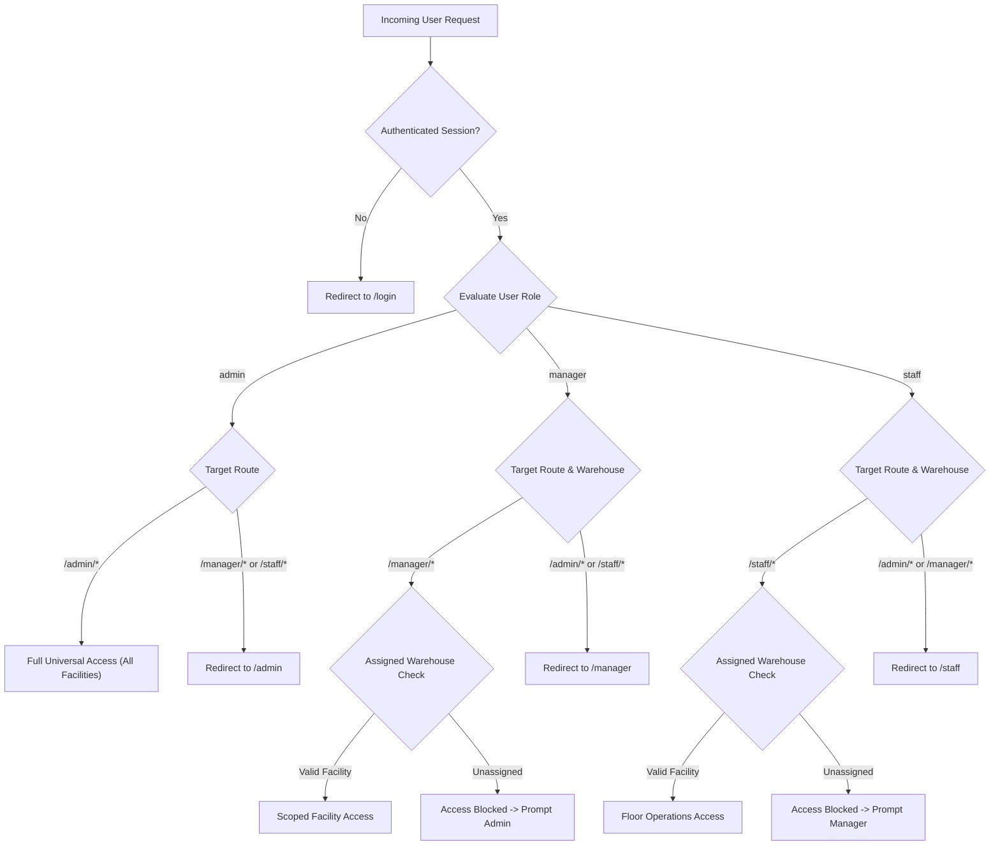

# VISTA Enterprise Field Inventory Management System
# Complete Operational & Execution Manual (End-to-End Guide)

---

## Table of Contents
1. [System Architecture & Startup](#1-system-architecture--startup)
2. [Role-Based Access Control (RBAC) & Warehouse Scoping Barrier](#2-role-based-access-control-rbac--warehouse-scoping-barrier)
3. [Super Admin Tier: Complete Tab & Route Directory](#3-super-admin-tier-complete-tab--route-directory)
4. [Inventory Manager Tier: Complete Tab & Route Directory](#4-inventory-manager-tier-complete-tab--route-directory)
5. [Warehouse Floor Staff Tier: Complete Tab & Route Directory](#5-warehouse-floor-staff-tier-complete-tab--route-directory)
6. [Comprehensive End-to-End Operational Walkthrough (Unified Example)](#6-comprehensive-end-to-end-operational-walkthrough-unified-example)
   - [Phase 1: Admin Provisions Facility, Manager & Staff](#phase-1-admin-provisions-facility-manager--staff)
   - [Phase 2: Admin Catalog Provisioning & Initial Stock Inbound](#phase-2-admin-catalog-provisioning--initial-stock-inbound)
   - [Phase 3: Inter-Facility Stock Transfer from Central Hub to Regional Depot](#phase-3-inter-facility-stock-transfer-from-central-hub-to-regional-depot)
   - [Phase 4: Staff Receiving, Inspection & Storage Bay Putaway](#phase-4-staff-receiving-inspection--storage-bay-putaway)
   - [Phase 5: Staff Floor Replenishment Request & Dynamic Manager Routing](#phase-5-staff-floor-replenishment-request--dynamic-manager-routing)
   - [Phase 6: Manager Review, Authorization & Request Approval](#phase-6-manager-review-authorization--request-approval)
   - [Phase 7: Outbound Clinical Ward Issuing & Dispensing](#phase-7-outbound-clinical-ward-issuing--dispensing)
   - [Phase 8: Blind Physical Cycle Count, Variance Detection & Ledger Adjustment](#phase-8-blind-physical-cycle-count-variance-detection--ledger-adjustment)
   - [Phase 9: Emergency Spot Purchase & Petty Cash Reimbursement](#phase-9-emergency-spot-purchase--petty-cash-reimbursement)
   - [Phase 10: Reverse Logistics, Ward Returns & Quarantine Inspection](#phase-10-reverse-logistics-ward-returns--quarantine-inspection)
   - [Phase 11: Real-Time Valuation, Executive Audit Trails & Financial Reports](#phase-11-real-time-valuation-executive-audit-trails--financial-reports)
7. [System Performance Architecture & Anti-Loop Polling Guards](#7-system-performance-architecture--anti-loop-polling-guards)

---

## 1. System Architecture & Startup

The **VISTA Field Inventory Management System** is an enterprise-grade platform engineered for real-time tracking of medical, pharmaceutical, and humanitarian emergency inventory across distributed regional warehouses, transit depots, and forward field clinics.

### Technology Stack
- **Framework**: Next.js 16 (React 19, App Router architecture)
- **Language**: TypeScript 5 (Strict type checking enabled)
- **Styling**: Tailwind CSS with custom enterprise design system
- **Database Engine**: Neon Serverless PostgreSQL with pooling (`@neondatabase/serverless`)
- **Ledger Reliability**: Dual-layer persistence with live database transactions and global runtime memory caching
- **Icons & Visuals**: Lucide React Icons

### Prerequisites
- Node.js `v20.x` or `v22.x` (LTS recommended)
- PostgreSQL database credentials (set in `.env.local` as `DATABASE_URL`)

### Starting the System
```powershell
# 1. Navigate to the project directory
cd "vista-portal"

# 2. Install dependencies (if not already installed)
npm install

# 3. Launch development server with local environment configuration
npm run dev
```

The system will be live at:
```
http://localhost:3000
```

### Pre-Configured Demo Credentials
| Role | Email / Identifier | Password | Default Scope | Target URL |
| :--- | :--- | :--- | :--- | :--- |
| **Super Admin** | `admin@vista.com` (or `admin`) | `admin123` | Global Access (All Depots) | `http://localhost:3000/admin` |
| **Inventory Manager** | `manager@vista.com` (or `manager`) | `manager123` | Scoped Facility | `http://localhost:3000/manager` |
| **Warehouse Staff** | `staff@vista.com` (or `staff`) | `staff123` | Assigned Bays & Depots | `http://localhost:3000/staff` |

---

## 2. Role-Based Access Control (RBAC) & Warehouse Scoping Barrier

VISTA enforces **Warehouse Scoping Isolation** at both layout navigation and API endpoint layers:



### Key Principles of Isolation:
1. **Universal Admin Governance**: Super Admins see nationwide consolidated stock, can transfer across any depot, create new facilities, and assign managers to depots.
2. **Manager Scoping**: A Manager can only review, approve, and audit inventory within the facility assigned to them in `users.assigned_warehouse_id` or `user_warehouse_assignments`.
3. **Staff Floor Boundary**: Staff can only view bins, receive goods, perform cycle counts, and execute issues within warehouses assigned to their profile.
4. **Multi-Warehouse Assignment**: Staff members assigned to multiple regional depots can seamlessly switch between their authorized facilities without accessing unauthorized depots.

---

## 3. Super Admin Tier: Complete Tab & Route Directory

The Super Admin interface (`/admin`) provides global oversight and control across all depots nationwide.

```
/admin
├── /admin/warehouses       (Regional Depots & Capacity Master)
├── /admin/users            (Enterprise Staff & Manager Provisioning)
├── /admin/items            (Master SKU Catalog, Barcodes & Pricing)
├── /admin/kits             (Bill of Materials & Disaster Pack Master)
├── /admin/movements        (Universal Inbound/Outbound Stock Ledger)
├── /admin/stock-overview   (Consolidated Multi-Warehouse Stock)
├── /admin/transfers        (Inter-Depot Transfer Authorizations)
├── /admin/adjustments      (Master Stock Write-Offs & Adjustments)
├── /admin/requests         (Nationwide Requisitions Overview)
├── /admin/returns          (Consolidated Reverse Logistics & Condemned Lots)
├── /admin/reports          (Inventory Valuation, FEFO Aging & Financials)
├── /admin/audit-logs       (Tamper-Evident Transaction Trail)
└── /admin/settings         (System Governance & Security Defaults)
```

### Detail of Every Admin Tab

#### 1. Global Dashboard (`/admin`)
- **Key Cards**: Total Inventory Valuation ($), Active SKUs, In-Transit Inter-Depot Transfers, Pending Critical Approvals.
- **Visuals**: Nationwide stock distribution donut chart, occupancy trend lines, recent system-wide alerts.
- **Quick Action Modals**: Quick Transfer, Quick Master Catalog Addition, Emergency Procurement Trigger.

#### 2. Warehouses & Facilities (`/admin/warehouses`)
- **Functionality**: Create, configure, and inspect warehouse facilities across all regions.
- **Fields**: Facility Code (e.g. `WH-006-88`), Name, City, Type (Central Hub, Regional Depot, Cold-Chain Facility), Storage Capacity ($m^3$), Total Storage Bins, Has Cold-Chain, Assigned Facility Director.
- **Action**: "+ Add Warehouse" opens modal to provision new facility into PostgreSQL `warehouses` table.

#### 3. User Management & Provisioning (`/admin/users`)
- **Functionality**: Authorize user registrations, assign roles (`super_admin`, `manager`, `staff`), and assign designated warehouses.
- **Fields**: User Name, Email, Role, Department, Assigned Warehouse, Account Status (Active/Suspended/Pending Approval).
- **Actions**: Approve pending signups, edit user roles, reassign warehouse depots, suspend access.

#### 4. Master Item Catalog (`/admin/items`)
- **Functionality**: The single source of truth for all medical, pharmaceutical, and emergency goods.
- **Fields**: SKU/Item Code (e.g. `VS 15`), Item Name, Category (Medicines, Surgical Supplies, Cold-Chain, PPE), Unit of Measure (Box, Vial, Pack, Kit), Unit Cost ($), Safety Reorder Threshold, Expiry Tracking Toggle, Batch Tracking Toggle.
- **Actions**: "+ Add Item", "Import CSV/Excel", "Print Barcode Labels", "Edit Item Details".

#### 5. Medical Kits & Bill of Materials (`/admin/kits`)
- **Functionality**: Define pre-packed emergency medical response kits (e.g., Trauma Response Kit, Cholera Treatment Kit, Maternal Health Pack).
- **Configuration**: Kit Code, Kit Name, Target Recipient, Component Breakdown (SKU + Required Quantity per kit).
- **Inventory Link**: Deducts constituent raw SKUs when floor staff packs kits.

#### 6. Stock Overview by Location (`/admin/stock-overview`)
- **Functionality**: Real-time cross-tabulation of stock balances by depot, category, and storage zone.
- **Capabilities**: Filter by facility, search by batch number or expiry date, view total vs reserved vs available inventory.

#### 7. Inter-Depot Transfers (`/admin/transfers`)
- **Functionality**: Authorize and dispatch stock movements between central hubs and regional depots.
- **Fields**: Transfer Reference, Origin Facility, Destination Facility, Dispatched Items, Carrier Name, Manifest Status (`Pending`, `In Transit`, `Delivered`, `Cancelled`).

#### 8. Adjustments & Write-Offs (`/admin/adjustments`)
- **Functionality**: High-level governance of cycle count discrepancies, shrinkage write-offs, and damaged stock approvals.
- **Threshold Policy**: Any discrepancy exceeding $1,000 automatically requires Super Admin co-signature.

#### 9. Reports & Financial Valuation (`/admin/reports`)
- **Functionality**: Exportable inventory valuation ledgers, ABC inventory classification analysis, dead-stock monitoring, and operational turnover velocity.
- **Export Formats**: Automated CSV, PDF audit reports, and live analytical digest.

#### 10. Audit Logs (`/admin/audit-logs`)
- **Functionality**: Immutable audit trail recording every user login, stock increment, deduction, approval, transfer, and adjustment with timestamp, user ID, and IP address.

---

## 4. Inventory Manager Tier: Complete Tab & Route Directory

The Inventory Manager interface (`/manager`) is dedicated to facility-level operations, supervisor sign-offs, and floor oversight.

```
/manager
├── /manager/approvals          (Unified Floor Submissions Clearinghouse)
├── /manager/requests           (Stock Replenishment Review & Authorizations)
├── /manager/stock              (Facility Bins & Live Balance Telemetry)
├── /manager/receiving-issuing  (Dock Inbound & Outbound Dispatch Oversight)
├── /manager/adjustments        (Variance Investigations & Recount Dispatch)
├── /manager/discrepancies      (Damage, Loss & Floor Discrepancy Audits)
├── /manager/returns            (Ward Returns & Reverse Logistics Restocking)
├── /manager/expiry             (FEFO First-Expired-First-Out Risk Monitor)
├── /manager/transfers          (Outbound Manifest Dispatch & Freight Receipt)
├── /manager/purchases          (Local Spot Procurement & Invoice Sign-Off)
├── /manager/kits               (Facility Kit Packing & Staging Control)
├── /manager/staff              (Floor Workforce Roster & Task Progress)
├── /manager/reports            (Facility Throughput & Storage Utilization)
└── /manager/settings           (Warehouse Operating Hours & Bay Thresholds)
```

### Detail of Key Manager Tabs

#### 1. Facility Dashboard (`/manager`)
- **Overview**: Real-time bin occupancy, pending review badges, stockout alerts, and live shift progress.
- **Status Indicator**: Confirms active facility assignment (e.g. `[WH-006-88] Islamabad Central Depot`).

#### 2. Stock Requests Review Desk (`/manager/requests`)
- **Functionality**: Evaluates stock replenishment requests submitted by floor staff.
- **Workflow Actions**:
  - **Approve**: Confirms request, records manager user ID into `reviewed_by_id` and `approved_by_id`, updates status to `Approved`, and triggers outbound pick tasks for floor staff.
  - **Reject**: Rejects request with documented reason, notifying requester.

#### 3. Physical Adjustments & Recounts (`/manager/adjustments`)
- **Functionality**: Reviews blind cycle count variances submitted by floor staff.
- **Manager Powers**:
  - **Approve Adjustment**: Accepts variance, writes off shrinkage/gain, adjusts `stock_balances`.
  - **Dispatch Recount**: Rejects initial tally and dispatches an urgent recount task directly to the floor staff shift queue.

#### 4. FEFO Expiry & Batch Monitor (`/manager/expiry`)
- **Functionality**: First-Expired-First-Out inventory management.
- **Color Coding**: Critical (< 30 days), Warning (30–90 days), Healthy (> 90 days).
- **Actions**: Mark batch for prioritized ward dispatch or trigger quarantine disposal write-off.

#### 5. Local Purchase Authorizations (`/manager/purchases`)
- **Functionality**: Reviews emergency spot purchases made by floor staff at local suppliers.
- **Fields**: Vendor Name, Item Description, Quantity, Total Amount ($), Physical Invoice Attachment, Justification.
- **Action**: Authorizes petty cash disbursement and adds stock into facility ledger.

#### 6. Staff Shift Roster (`/manager/staff`)
- **Functionality**: Monitors floor staff assigned to this facility, tracks real-time task completion rate, and reallocates storage zones.

---

## 5. Warehouse Floor Staff Tier: Complete Tab & Route Directory

The Warehouse Floor Staff interface (`/staff`) is optimized for hands-on warehouse tasks, barcode scanning, bin counts, and dock operations.

```
/staff
├── /staff                      (Floor Workstation, Active Pick Order & Quick Actions)
├── /staff/receive              (Inbound Dock Receiving & Pallet Putaway)
├── /staff/issue                (Clinical Ward Issue & Signed Dispatch Vouchers)
├── /staff/stock                (Live Bin Stock Lookup & Reorder Alerts)
├── /staff/requests             (Submit Replenishment Requisitions to Manager)
├── /staff/cycle-counts         (Blind Physical Stock Counts & Variance Log)
├── /staff/damages              (Log Damaged Cartons & Quarantine Staging)
├── /staff/discrepancies        (Report Missing Stock & Dock Shortages)
├── /staff/kits                 (Assemble BOM Medical Kits & Print Packing Slips)
├── /staff/returns              (Record Unopened Ward Returns & Floor Usage)
├── /staff/transfers            (Receive In-Transit Freight & Log Transfer Out)
├── /staff/purchases            (Log Local Emergency Spot Purchases & Receipts)
└── /staff/settings             (Staff Station Preferences & Scanner Config)
```

### Detail of Key Staff Tabs

#### 1. Operations Workstation (`/staff`)
- **Active Order Workstation**: Displays high-priority picking orders with live barcode scan verification.
- **Shift Progress Tracker**: Displays tasks completed vs pending for the active shift.
- **Quick Action Launchers**: Direct 1-click modal access to Receive, Issue, Count, Request, and Kit Pack.

#### 2. Inbound Dock Receiving (`/staff/receive`)
- **Workflow**:
  1. Delivery carrier arrives at warehouse dock.
  2. Staff inputs PO / Bill of Lading Number.
  3. Staff selects Item SKU, enters received quantity, lot/batch number, and expiration date.
  4. Staff selects target storage bay (e.g. `Bay A-01`).
  5. System increments `stock_balances` and writes an `INBOUND` record in `stock_movements`.
  6. Generates a printable Goods Received Note (GRN) voucher.

#### 3. Outbound Ward Dispensing (`/staff/issue`)
- **Workflow**:
  1. Clinical department or nurse requests supplies against an approved requisition.
  2. Staff inputs Recipient Name, Department (e.g., Emergency Ward, ICU, Surgical Theater).
  3. Staff picks items from designated bay, verifying lot and quantity.
  4. Recipient signs digital voucher.
  5. System deducts quantity from `stock_balances` and logs `OUTBOUND` movement.

#### 4. Replenishment Requests (`/staff/requests`)
- **Workflow**:
  1. Staff clicks "+ New Stock Request".
  2. Dynamic Requisition Modal opens:
     - Automatically displays authorized warehouse facilities.
     - Automatically resolves and displays the assigned Reviewing Manager (name, phone, email).
     - Staff selects any item from the full catalog (searchable by SKU, name, or category).
     - Live card reveals current stock in the selected warehouse and reorder safety threshold.
     - Staff selects destination storage bay and sets Urgency (`Normal`, `High`, `Urgent`, `Low`).
     - Staff clicks one-click justification chip or writes reason.
  3. Modal previews live dossier of the request.
  4. Click "Submit Request to Manager" sends request directly into the facility manager's approval queue.

#### 5. Physical Cycle Audits (`/staff/cycle-counts`)
- **Workflow**:
  1. Staff walks to assigned physical rack (e.g. `Bay A-02`).
  2. Blind Count: Staff counts physical packages on shelf and types count.
  3. System automatically calculates variance against system records:
     - If count matches: Bin marked "Verified & Accurate" (100% accuracy).
     - If variance exists: Variance quantity (e.g. `-2 units`) highlighted in rose, automatically triggering an investigation record in `stock_adjustments` for manager sign-off.

---

## 6. Comprehensive End-to-End Operational Walkthrough (Unified Example)

To demonstrate how the entire VISTA system operates cohesively, we follow a single, unified operational story:

> **Scenario**:
> A critical shortage of **Exam Powder (SKU: `VS 15`)** occurs at the **Islamabad Central Depot (`WH-006-88`)**.
> We follow the entire chain of events from user provisioning to inter-depot transfer, floor putaway, requisition routing, approval, clinical issuing, and cycle audit.

```mermaid
sequenceDiagram
    autonumber
    actor Admin as Super Admin (John)
    actor Mgr as Manager (Hammad)
    actor Staff as Floor Staff (Ishaq)
    actor Nurse as Ward Nurse (Amina)
    participant API as VISTA Backend API
    participant DB as Neon PostgreSQL DB

    Note over Admin,DB: PHASE 1: Facility & User Provisioning
    Admin->>API: POST /api/warehouses (Create [WH-006-88] Islamabad)
    Admin->>API: POST /api/users (Create Manager Hammad & Staff Ishaq)
    Admin->>API: POST /api/items (Create Master SKU 'VS 15')

    Note over Admin,DB: PHASE 2: Inter-Depot Transfer
    Admin->>API: POST /api/transfers (Transfer 300x 'VS 15' from Central Hub to Islamabad)
    API->>DB: Status: 'In Transit' (Carrier: MedFreight Logistics)

    Note over Staff,DB: PHASE 3: Receiving & Putaway
    Staff->>API: POST /api/movements/receive (Dock 2: Receive 300x 'VS 15' into Bay A-01)
    API->>DB: Increment stock_balances (Islamabad: 300 boxes)

    Note over Staff,DB: PHASE 4: Replenishment Requisition
    Staff->>API: POST /api/requests (Request 100x 'VS 15' for Bay A-01, Urgency: High)
    API->>DB: Create stock_requests (Status: 'Pending', Assigned Mgr: Hammad)

    Note over Mgr,DB: PHASE 5: Manager Review & Approval
    Mgr->>API: GET /api/requests (Review requisition #SR-2026-838)
    Mgr->>API: PATCH /api/requests (Approve Requisition)
    API->>DB: Status: 'Approved' (Approved by: Hammad)

    Note over Staff,Nurse: PHASE 6: Clinical Ward Issue
    Nurse->>Staff: Requests 50 boxes for Outpatient Surgery
    Staff->>API: POST /api/movements/issue (Issue 50x 'VS 15' to Amina, Voucher #ISS-9041)
    API->>DB: Decrement stock_balances (Islamabad: 250 boxes remaining)

    Note over Staff,Mgr: PHASE 7: Physical Cycle Count & Discrepancy
    Staff->>API: POST /api/adjustments (Count Bay A-01: Found 248, Variance: -2)
    API->>DB: Status: 'Pending Manager Approval'
    Mgr->>API: PATCH /api/adjustments (Approve Write-off: Damaged seal in transit)
    API->>DB: Ledger updated to 248 boxes + Audit log recorded
```



---

### Phase 1: Admin Provisions Facility, Manager & Staff

1. **Admin logs in** at `/login` with credentials `admin@vista.com` / `admin123`.
2. Admin navigates to `/admin/warehouses` and clicks **"+ Add Warehouse"**:
   - **Warehouse Code**: `WH-006-88`
   - **Name**: `Islamabad Central Depot`
   - **City**: `Islamabad`
   - **Address**: `Sector I-9 Industrial Area`
   - **Type**: `Regional Depot`
   - **Capacity**: `4,500 m³`
   - **Cold Chain**: `Yes (2°C - 8°C & Ambient)`
   - *System writes to `warehouses` table in PostgreSQL.*
3. Admin navigates to `/admin/users` and clicks **"+ Add User"** to provision the Manager:
   - **Full Name**: `Hammad Manager`
   - **Email**: `manager.hammad@gmail.com`
   - **Role**: `manager`
   - **Assigned Facility**: `[WH-006-88] Islamabad Central Depot`
4. Admin provisions the Warehouse Floor Staff:
   - **Full Name**: `Ishaq Staff`
   - **Email**: `ishaq10866@gmail.com`
   - **Role**: `staff`
   - **Assigned Facility**: `[WH-006-88] Islamabad Central Depot`
   - *System records assignments in both `users.assigned_warehouse_id` and `user_warehouse_assignments`.*

---

### Phase 2: Admin Catalog Provisioning & Initial Stock Inbound

1. Admin navigates to `/admin/items` and clicks **"+ Add Item"**:
   - **SKU Code**: `VS 15`
   - **Item Name**: `Exam Powder`
   - **Category**: `Consumables & PPE`
   - **Unit**: `Box`
   - **Unit Cost**: `$45.00`
   - **Safety Reorder Level**: `100`
   - **Tracking**: Batch Tracking = `True`, Expiry Tracking = `True`
2. At Central Medical Store Hub (`wh-001`), an inbound container of 1,000 boxes of `VS 15` is received:
   - Batch: `LOT-2026-EP01`
   - Expiration Date: `2028-12-31`
   - Putaway Bay: `Central-Bay-01`
   - Total System Stock: `1,000 units` ($45,000 valuation).

---

### Phase 3: Inter-Facility Stock Transfer from Central Hub to Regional Depot

1. Admin navigates to `/admin/transfers` and clicks **"+ New Transfer Manifest"**:
   - **Source Warehouse**: `[WH-001] Central Medical Store`
   - **Destination Warehouse**: `[WH-006-88] Islamabad Central Depot`
   - **Item**: `VS 15 (Exam Powder)`
   - **Quantity**: `300 Boxes`
   - **Carrier**: `MedFreight Express (Truck #ISB-4921)`
   - **Priority**: `High Priority Transfer`
2. Admin clicks **"Authorize Transfer"**:
   - System updates Central Hub available stock: `1,000 - 300 = 700 Boxes`.
   - Generates Transfer Manifest: `TRF-2026-001`.
   - Status transitions to `In Transit`.

---

### Phase 4: Staff Receiving, Inspection & Storage Bay Putaway

1. Freight truck `#ISB-4921` arrives at Islamabad Central Depot dock bay 2.
2. Staff **Ishaq** logs in at `/login` (`ishaq10866@gmail.com` / `staff123`) and is routed to `/staff`.
3. Ishaq clicks **"Receive Inbound Stock"** (or navigates to `/staff/receive`):
   - **Reference / PO**: `TRF-2026-001`
   - **Item Selected**: `[VS 15] Exam Powder`
   - **Verified Quantity**: `300 Boxes`
   - **Lot / Batch Number**: `LOT-2026-EP01`
   - **Expiry Date**: `12/31/2028`
   - **Destination Storage Bay**: `Bay A-01`
4. Ishaq clicks **"Confirm Inbound Receipt"**:
   - Database writes `INBOUND` record to `stock_movements`.
   - Database increments `stock_balances` in Islamabad Depot for `Bay A-01` to `300 Boxes`.
   - Staff prints verified dock receiving slip.

---

### Phase 5: Staff Floor Replenishment Request & Dynamic Manager Routing

1. Over the next two weeks, 220 boxes are issued to clinical wards. Stock in `Bay A-01` falls to `80 Boxes` (below the safety reorder threshold of 100).
2. Staff **Ishaq** navigates to `/staff/requests` and clicks **"+ New Stock Request"**:
   - The **Dynamic Replenishment Modal** opens:
     - **Target Warehouse**: Displays `[WH-006-88] Islamabad Central Depot` (or allows switching between authorized facilities).
     - **Assigned Approving Manager Card**: Automatically resolves and displays **Hammad Manager** (`manager.hammad@gmail.com`, `+977 3456789012`).
     - **Item Selector**: Staff types `VS 15` in the search box; the card dynamically updates showing:
       - Current stock in depot: `80 Boxes`
       - Safety threshold: `100 Boxes`
       - Health Status: **Below Safety (Amber Badge)**
     - **Destination Bay**: `Bay A-01`
     - **Requested Quantity**: `100 Boxes`
     - **Urgency**: `High (Floor Depleting Soon)`
     - **Reason Preset**: Clicks chip *"Bin inventory below safety threshold."*
     - **Live Requisition Dossier**: Previews the complete request breakdown and confirms routing to Manager Hammad.
3. Ishaq clicks **"Submit Request to Manager"**:
   - Requisition `#SR-2026-838` is written to `stock_requests`.
   - Toast confirms: *"Submitted replenishment request for 100 units of VS 15 to Manager (Hammad Manager)."*

---

### Phase 6: Manager Review, Authorization & Request Approval

1. Manager **Hammad** logs in at `/login` and is redirected to `/manager`.
2. The Manager Dashboard displays badge: `1 Pending Stock Requisition`.
3. Hammad clicks **"Requests Review"** (`/manager/requests`):
   - Table displays Requisition `#SR-2026-838`:
     - **Requester**: `Ishaq Staff (Floor Specialist)`
     - **Facility**: `[WH-006-88] Islamabad Central Depot`
     - **Item**: `VS 15 (Exam Powder)`
     - **Quantity**: `100 Box`
     - **Priority**: `High`
     - **Reason**: `Bin inventory below safety threshold.`
     - **Status**: `Pending Review`
4. Manager Hammad inspects facility budget and clicks **"Approve"**:
   - System calls `PATCH /api/requests` with `{ id: "sr-...", action: "approve" }`.
   - Manager user ID is recorded in `reviewed_by_id` and `approved_by_id`.
   - Requisition status updates to `Approved` in real-time.
   - Floor Staff queue receives notification to stage restock replenishment.

---

### Phase 7: Outbound Clinical Ward Issuing & Dispensing

1. Staff **Ishaq** receives a clinical requisition from **Nurse Amina** (Inpatient Surgical Ward).
2. Ishaq navigates to `/staff/issue`:
   - **Requisition Voucher**: `ISS-2026-9041`
   - **Recipient Name**: `Nurse Amina`
   - **Department**: `General Surgery / Ward 4`
   - **Item Code**: `VS 15`
   - **Source Bay**: `Bay A-01`
   - **Quantity Issued**: `30 Boxes`
3. Nurse Amina reviews packages, verifies intact lot seals, and signs the voucher.
4. Ishaq clicks **"Confirm Stock Issue"**:
   - Database writes `OUTBOUND` record to `stock_movements`.
   - Database decrements `stock_balances` in `Bay A-01`: `80 - 30 = 50 Boxes`.
   - Official signed dispatch voucher is generated and downloaded as PDF.

---

### Phase 8: Blind Physical Cycle Count, Variance Detection & Ledger Adjustment

1. During Friday physical audits, Staff **Ishaq** conducts a blind cycle count of `Bay A-01` (`/staff/cycle-counts`):
   - Staff physically counts packages on rack shelf: **48 Boxes**.
   - System record expects: **50 Boxes**.
   - **Detected Variance**: `-2 Boxes` (Shortage).
2. Ishaq logs the audit:
   - **Physical Count**: `48`
   - **Variance**: `-2`
   - **Discrepancy Justification**: *"2 boxes damaged during transit cart loading; seals broken."*
   - Clicks **"Submit Count for Manager Audit"**.
3. Manager **Hammad** opens `/manager/adjustments`:
   - Reviews discrepancy of `-2 Boxes` on `VS 15` in `Bay A-01`.
   - Inspects incident report.
   - Manager clicks **"Approve Adjustment"**:
     - Status updates to `Approved`.
     - Ledger balance updates to exact shelf count: `48 Boxes`.
     - Audit log registers: *"Variance of -2 units written off under damaged transit write-off authorized by Hammad Manager."*

---

### Phase 9: Emergency Spot Purchase & Petty Cash Reimbursement

1. Over the weekend, an emergency cholera surge requires immediate sterile gloves not available from central supply.
2. Floor Staff **Ishaq** buys 20 boxes at a local chemist for `$180.00` using petty cash emergency protocol.
3. Ishaq opens `/staff/purchases` and clicks **"+ Record Emergency Purchase"**:
   - **Vendor**: `Shaheen Chemist & Surgical Supplies`
   - **Invoice Number**: `INV-SH-4981`
   - **Item Purchased**: `Sterile Nitrile Gloves`
   - **Quantity**: `20 Boxes`
   - **Total Amount**: `$180.00`
   - **Urgency Justification**: *"Weekend emergency surgery surge - central warehouse closed."*
4. Manager **Hammad** opens `/manager/purchases`, audits the receipt invoice, and clicks **"Approve & Reimburse"**:
   - Petty cash disbursement authorized.
   - Gloves added to active depot stock.

---

### Phase 10: Reverse Logistics, Ward Returns & Quarantine Inspection

1. After surgery, surgical ward returns 5 unopened, sealed boxes of sterile gauze.
2. Floor Staff opens `/staff/returns`:
   - **Return Reference**: `RET-2026-042`
   - **Originating Ward**: `ICU Recovery`
   - **Condition**: `Intact & Sterility Seal Verified`
   - **Quantity**: `5 Boxes`
3. Manager **Hammad** opens `/manager/returns`:
   - Inspects chain-of-custody log.
   - Clicks **"Authorize Shelf Restock"**:
     - System increments active storage bin balance.
     - Units restored to live available inventory.
   *(Note: If packaging were torn, Manager would click **"Condemn to Quarantine"**, sending items to Disposal Bay `Q-01` as non-usable hazardous medical waste).*

---

### Phase 11: Real-Time Valuation, Executive Audit Trails & Financial Reports

1. At month-end, Super Admin **John** logs in to `/admin/reports`:
   - **Consolidated Valuation**: Real-time monetary valuation of all nationwide stock.
   - **Throughput Velocity**: Shows turnover rates across Central Hub, Islamabad Depot, and Pokhara Depot.
   - **Discrepancy Rate**: Confirms inventory accuracy rate across all depots at `99.4%`.
2. Admin opens `/admin/audit-logs`:
   - Every single event—from the initial transfer of `VS 15`, to dock receiving by Ishaq, replenishment authorization by Hammad, clinical issue to Amina, and cycle recount write-off—appears chronologically in an exportable, tamper-evident audit ledger.

---

## 7. System Performance Architecture & Anti-Loop Polling Guards

To guarantee optimal performance, rapid page load speeds (< 200ms), and zero redundant server queries, the VISTA architecture enforces the following frontend and backend guards:

### 1. Conditional Component Mounting
Modals with API integrations (such as [SubmitRequestModal.tsx](file:///C:/Users/DRECT%20BUY/Desktop/CGL/VISTA%20porta/vista-portal/components/staff/modals/SubmitRequestModal.tsx)) are conditionally mounted in the DOM:
```tsx
// Pattern applied across all pages:
{isModalOpen && (
  <SubmitRequestModal
    isOpen={isModalOpen}
    onClose={() => setIsModalOpen(false)}
    onSubmitRequest={handleCreateRequest}
  />
)}
```
When closed, the modal is unmounted completely, resulting in **zero** memory footprint and **zero** background HTTP requests.

### 2. Elimination of Cascading `useEffect` Dependency Loops
- Effect dependencies use stable scalar primitives (`whId: string`, `isOpen: boolean`) rather than object/array references (`[]`).
- Warehouse facilities are fetched **strictly once** on modal open.
- The heavy `/api/staff/dashboard` endpoint (which performs 10 complex multi-table analytical KPI queries) is strictly excluded from modal workflows. Storage bays utilize stable pre-configured identifiers and passed props.

### 3. User-Action Triggered Item Resolution
Catalog item searches query `/api/items?warehouseId={id}` strictly when:
- The modal is initially opened, OR
- The user selects a different warehouse facility from the dropdown selector.

### 4. Database Foreign-Key Resiliency
When staff or managers execute operations, server-side auth guards in [lib/auth-scope.ts](file:///C:/Users/DRECT%20BUY/Desktop/CGL/VISTA%20porta/vista-portal/lib/auth-scope.ts) and [app/api/requests/route.ts](file:///C:/Users/DRECT%20BUY/Desktop/CGL/VISTA%20porta/vista-portal/app/api/requests/route.ts) verify real-time user existence in the Neon PostgreSQL database, automatically reconciling any session discrepancies and preventing foreign-key constraint rejections.

---

*End of VISTA Operational Manual. For system configuration questions, refer to the project [README.md](file:///C:/Users/DRECT%20BUY/Desktop/CGL/VISTA%20porta/vista-portal/README.md).*
